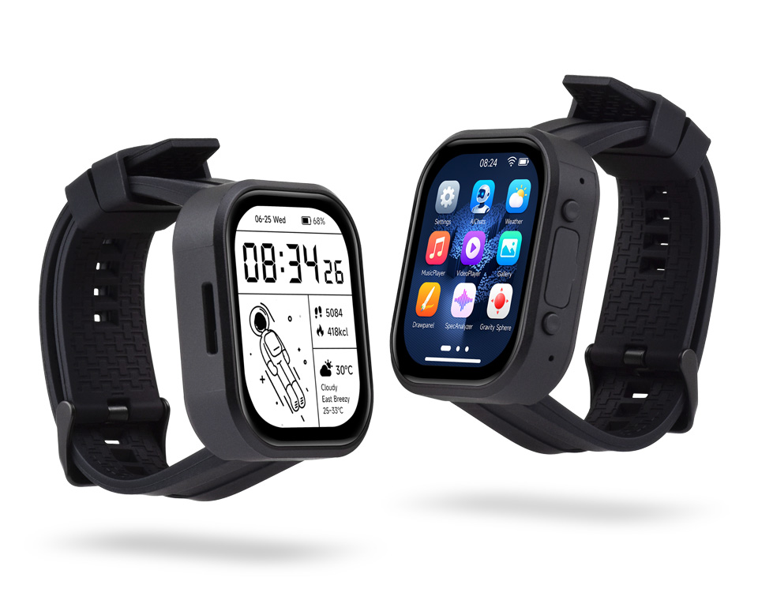

  <h1>ESP32-S3-Touch-AMOLED-2.06</h1>
  
<strong>ESP32-S3 2.06-inch 410 x 502 QSPI AMOLED touch development board</strong>

  
<strong>English</strong> | <a href="README_ZH.md">简体中文</a>

  

    
    
    
  

  

    <a href="https://www.waveshare.com/esp32-s3-touch-amoled-2.06.htm">🌐 Product</a> &middot;
    <a href="https://github.com/waveshareteam/ESP32-S3-Touch-AMOLED-2.06/releases/latest">📦 Firmware</a> &middot;
    <a href="examples/esp-idf/">🧩 ESP-IDF</a> &middot;
    <a href="examples/arduino/examples/">🔧 Arduino</a> &middot;
    <a href="hardware/">📚 Documentation</a>
  

  

---

## ✨ Overview

The ESP32-S3-Touch-AMOLED-2.06 is a watch-style development board that combines an ESP32-S3
with a 2.06-inch AMOLED touch display, a six-axis motion sensor, power management, and audio input
and output. This repository provides its ESP-IDF and Arduino examples, ready-to-flash example
firmware, the factory firmware source, and the schematic.

| Feature | Device / interface |
| --- | --- |
| MCU | ESP32-S3 |
| Display | 2.06-inch 410 x 502 QSPI AMOLED using CO5300 |
| Touch | FT3168 capacitive touch controller over I2C |
| Power management | AXP2101 |
| Motion sensor | QMI8658 six-axis IMU |
| Audio | Dual digital microphones via ES7210 ADC; ES8311 audio codec |
| Board support | Managed component: `waveshare/esp32_s3_touch_amoled_2_06` |

## 📦 Quick Start

The fastest way to try an example is a ready-to-flash package from the
[latest release](https://github.com/waveshareteam/ESP32-S3-Touch-AMOLED-2.06/releases/latest).

1. Download the `*-combined.zip` package for the example and framework version you need.
2. Extract the archive and install esptool with `python -m pip install esptool`.
3. Connect the board over USB.
4. Run `flash_combined.bat COMx` on Windows or `./flash_combined.sh /dev/ttyACM0` on Linux.
5. Reset the board if it does not restart automatically.

Factory firmware (restores the out-of-box demo): download the file whose name contains `factory_firmware` from the [Releases page](https://github.com/waveshareteam/ESP32-S3-Touch-AMOLED-2.06/releases). Its source is in [`factory_firmware/`](factory_firmware/).

## 🧪 Examples

### ESP-IDF

| Example | Main feature |
| --- | --- |
| [01_AXP2101](examples/esp-idf/01_AXP2101/) | Power management and battery telemetry |
| [02_lvgl_demo_v9](examples/esp-idf/02_lvgl_demo_v9/) | LVGL 9 display and touch demo |
| [03_esp-brookesia](examples/esp-idf/03_esp-brookesia/) | ESP-Brookesia application UI |
| [04_Immersive_block](examples/esp-idf/04_Immersive_block/) | Motion-driven LVGL block demo |
| [05_Spec_Analyzer](examples/esp-idf/05_Spec_Analyzer/) | Microphone spectrum analyzer |
| [06_videoplayer](examples/esp-idf/06_videoplayer/) | SD card video playback with audio |

### Arduino

| Example | Main feature |
| --- | --- |
| [01_HelloWorld](examples/arduino/examples/01_HelloWorld/) | Display initialization |
| [02_GFX_AsciiTable](examples/arduino/examples/02_GFX_AsciiTable/) | GFX text and glyph rendering |
| [03_LVGL_PCF85063_simpleTime](examples/arduino/examples/03_LVGL_PCF85063_simpleTime/) | LVGL clock UI using the PCF85063 RTC |
| [04_LVGL_QMI8658_ui](examples/arduino/examples/04_LVGL_QMI8658_ui/) | LVGL IMU data UI |
| [05_LVGL_AXP2101_ADC_Data](examples/arduino/examples/05_LVGL_AXP2101_ADC_Data/) | LVGL power and battery telemetry UI |
| [06_LVGL_Arduino_v9](examples/arduino/examples/06_LVGL_Arduino_v9/) | LVGL 9 UI demo |
| [07_LVGL_SD_Test](examples/arduino/examples/07_LVGL_SD_Test/) | SD card test |
| [08_ES8311](examples/arduino/examples/08_ES8311/) | ES8311 audio output |

Libraries used by the sketches are bundled in [`examples/arduino/libraries`](examples/arduino/libraries/).

## 🛠️ Development Environment

| Framework | Version | Examples |
| --- | --- | ---: |
| ESP-IDF | `v5.5.5` | 6 |
| ESP-IDF | `v6.0.2` | 6 |
| Arduino-ESP32 | `3.3.11` | 8 |

## 📚 Resources

- [Schematic](hardware/)
- [Product page](https://www.waveshare.com/esp32-s3-touch-amoled-2.06.htm)
- [Wiki](https://docs.waveshare.com/ESP32-S3-Touch-AMOLED-2.06)

## 🤝 Support

- Example or repository problem: [open an issue](https://github.com/waveshareteam/ESP32-S3-Touch-AMOLED-2.06/issues/new/choose).
- Product usage, hardware or order questions: [Waveshare support](https://service.waveshare.com/).

## 📄 License

Apache License 2.0. See [LICENSE](LICENSE).
